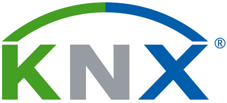
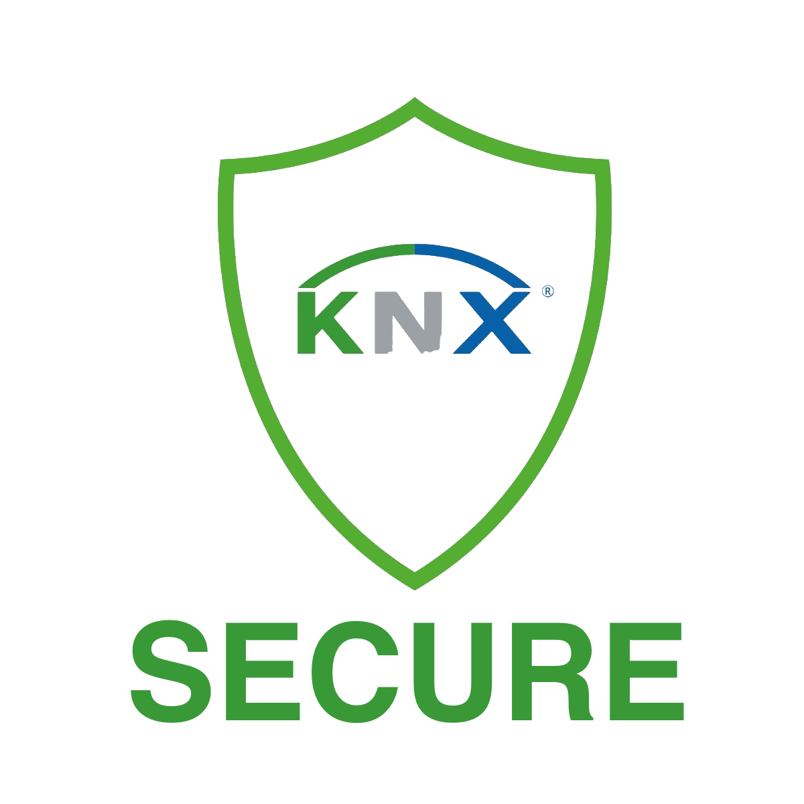

<p align="center">
  
</p>


## The worldwide KNX Engine node package

KNX protocol implementation for Node.js. It supports KNX/IP Tunneling/Routing, KNX/IP Secure and Data Secure, and FT1.2/KBerry TP — both plain KNX and the full secure KNX stack.
This is the official engine of Node-Red's node [node-red-contrib-knx-ultimate](https://flows.nodered.org/node/node-red-contrib-knx-ultimate)  

<br/>
<br/>
<br/>

[](https://github.com/Supergiovane/KNXUltimate/actions/workflows/ci.yml)
[![NPM version][npm-version-image]][npm-url]
[![NPM downloads per month][npm-downloads-month-image]][npm-url]
[![NPM downloads total][npm-downloads-total-image]][npm-url]
[![MIT License][license-image]][license-url]
[](https://standardjs.com)
[![Youtube][youtube-image]][youtube-url]
[](https://www.maxsupervibe.com)


<p align="center">
  
</p>

<br/>

```bash
  npm i knxultimate
```

<p align='center'>
</br></br></br>
</br></br>
<span style="font-size:0.5em;color:grey;">Authorized KNX logo by KNX Association*</span>
</p>


## Features

- **KNX/IP Tunnelling** over UDP and TCP (plain or secure)
- **KNX/IP Routing** over multicast (plain and secure), with ROUTING_BUSY flow control
- **KNX/IP Secure** full stack (session handshake + Secure Wrapper)
- **KNX Data Secure** — per-GA end-to-end encryption via ETS keyring
- **KNX TP serial** FT1.2 / KBerry / BAOS, with Data Secure on TP
- **Datapoint (DPT) encoding/decoding** for a massive number of datapoints
- **Discovery** of interfaces/routers (multicast + unicast)
- **Winston-based log stream** you can intercept programmatically

## Requirements

- **Node.js 18+**
- For **KNX Secure / Data Secure**: an ETS keyring (`.knxkeys`) file and its password, or the manual tunnel credentials (plus `groupKeys` for Data Secure)
- For **TP serial (FT1.2/KBerry)**: a supported serial interface (the `serialport` dependency is used under the hood)

## 📘 Documentation

The full documentation is on **[maxsupervibe.com](https://www.maxsupervibe.com/docs/knxultimate/)**, together with the help of every other Max Supervibe repo.

<p align="left" style="font-size:2.25rem;font-weight:700;line-height:1.9;">
  <a href="https://www.maxsupervibe.com/docs/knxultimate/">📘 Go to the documentation</a>
</p>

Release notes: [CHANGELOG.md](CHANGELOG.md)

[license-image]: https://img.shields.io/badge/license-MIT-blue.svg
[license-url]: https://github.com/Supergiovane/KNXUltimate/blob/master/LICENSE
[npm-url]: https://npmjs.org/package/knxultimate
[npm-version-image]: https://img.shields.io/npm/v/knxultimate.svg
[npm-downloads-month-image]: https://img.shields.io/npm/dm/knxultimate.svg
[npm-downloads-total-image]: https://img.shields.io/npm/dt/knxultimate.svg
[youtube-image]: https://img.shields.io/badge/Visit%20me-Youtube-red
[youtube-url]: https://www.youtube.com/channel/UCA9RsLps1IthT7fDSeUbRZw/playlists
